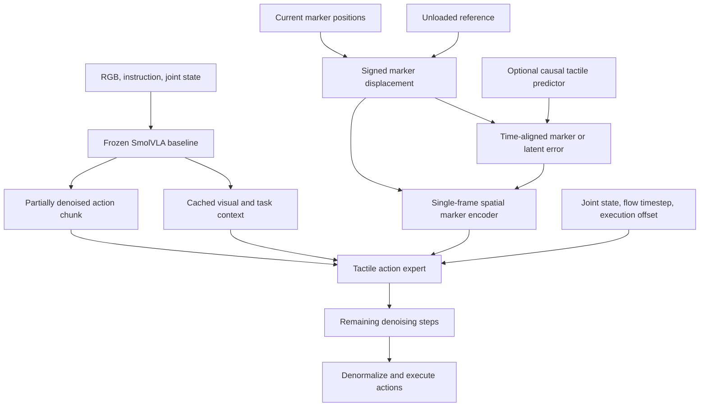

# Tactile Refinement

Research design note based on our UniVTAC / SmolVLA discussion, September 2026.

**Status:** The vision-language-proprioception baseline has been configured and trained in the existing workspace. The tactile refinement architecture below is a proposal, not an implemented or validated result. The latest design uses a single tactile observation and a fixed unloaded reference; a temporal history encoder is deferred.

## 1. Objective

Improve a tactile-unaware SmolVLA policy by adding a separate tactile expert that refines its partially denoised action chunk. The expert should respond to measured contact deformation and, in a subsequent variant, the discrepancy between predicted and measured tactile information.

The central hypothesis is that explicit, signed marker displacement exposes useful contact structure more directly than requiring an RGB encoder to discover it. This is a hypothesis to test against tactile RGB and other representations, not a claim that marker inputs are always superior.

The intended combination is:

- SmolVLA supplies task context and a coarse action proposal.
- A marker encoder represents current fingertip deformation relative to an unloaded reference.
- An optional predictor estimates expected tactile deformation.
- A tactile action expert uses measured deformation and prediction error to finish denoising the action chunk.

There is no universal rule mapping one tactile displacement vector to one joint correction. Robot configuration, sensor orientation, contact geometry, friction, and task intent all affect the appropriate response.

## 2. How the design evolved

| Discussion | Resulting decision or proposal |
|---|---|
| Establish a tactile-unaware VLA baseline | Use RGB, task text, and joint state; action supervision only. |
| Remove the proposed 90:10 partition | Train on all 800 source episodes; no training/validation split. |
| Explore LoRA and GPU capacity | Final baseline recipe uses dense fine-tuning, batch size 16, accumulation 4. |
| Investigate low loss and overlapping chunks | Keep overlapping action chunks; assess task quality through closed-loop evaluation. |
| Add a T-Rex-inspired tactile expert | Refine intermediate flow states using tactile conditioning and cached task context. |
| Compare predicted and actual tactile latents | Require a shared representation and matching physical timestamps. |
| Establish per-episode zero-contact references | Subtract a verified unloaded reference separately for each fingertip. |
| Simplify the first tactile representation | Defer history; prioritize the current marker displacement field. |
| Make the prediction discrepancy interpretable | Compare direct marker-space errors with latent-space errors in later experiments. |

## 3. Existing baseline and dataset

The baseline uses the Isaac Sim 4.5 portion of [UniVTAC](https://huggingface.co/datasets/byml/UniVTAC): 800 source episodes across eight tasks, with 152,079 usable observation/action pairs after respecting a recorded step discontinuity. Both segments of the affected episode remain in training.

| Setting | Baseline configuration |
|---|---|
| Initialization | `lerobot/smolvla_base` |
| Inputs | Head RGB, wrist RGB, task instruction, nine joint positions |
| Excluded from baseline inputs | Tactile data, actor/object state, depth, force |
| Objective | Action flow-matching loss only |
| Action target | Next recorded absolute joint position and subsequent positions in a chunk |
| Action dimension | Seven arm joints in radians and two finger joints in metres |
| Chunk size | 50 targets, constructed by the loader |
| Baseline replanning | Execute 10 actions before refreshing the policy observation |
| Batch / accumulation | 16 / 4, effective batch size 64 |
| Training budget | 72 hours on an RTX 3090 with 24 GiB VRAM |
| Training strategy | Dense vision encoder, connector, language backbone, action expert, and projections; no LoRA |
| Checkpoint schedule | `checkpoint_24h.pt`, `checkpoint_48h.pt`, `final.pt` |
| Partition | All episodes used for training; no holdout |

The parameter audit reports 402,737,376 trainable parameters. Another 47,308,800 parameters are architecture-unused output layers without an action-loss gradient path; describing the run as literally training every stored parameter would be inaccurate.

UniVTAC stores trajectories rather than predefined 50-action chunks. The loader constructs overlapping future targets at each timestep, pads short episode-end chunks, and excludes padding from the loss. Adjacent chunks are correlated; the frame count is not a count of independent demonstrations.

Actions are normalized per dimension:

$$
a_j^{\mathrm{norm}} = \frac{a_j-\mu_j}{\sigma_j}.
$$

Statistics come from the complete training dataset. The two finger dimensions have nearly identical means of 0.0086002 m and standard deviations of 0.0063021 m. Inference reverses the normalization before simulator execution. The simulator bridge uses seven arm values and the first finger prediction, broadcasting that gripper command to both fingers.

The action targets are recorded joint positions used as command proxies, rather than independently verified commanded-action logs. This distinction matters when training a tactile dynamics model.

Earlier status checks showed decreasing training loss and finite gradients. Low normalized flow-matching loss is not a physical joint error or proof of successful manipulation. Closed-loop evaluation remains necessary.

The benchmark scaffold records episode metrics and success summaries. Rollout video recording was disabled in that scaffold at the time of this discussion; UniVTAC itself supports MP4 recording. Video and action-trace logging should be enabled and verified before the refinement experiments. No evaluation results are claimed here.

## 4. Available tactile data and a schema finding

Both `tactile/left_gsmini/` and `tactile/right_gsmini/` contain:

| Field | Meaning and proposed use |
|---|---|
| `marker` | Reference/current 2D marker coordinates; primary input for the first experiment |
| `depth` | Sensor depth/height map; optional deformation-geometry input |
| `rgb` | Rendered tactile appearance; comparison representation |
| `rgb_marker` | Rendered appearance with markers; another image comparison |
| `pose` | Sensor attachment pose; separate context if needed |

There is no direct calibrated force/torque field in these tactile groups. Marker motion and depth must not be relabeled as force ground truth.

The downloaded marker arrays have per-frame shape `(2, 1200, 2)`. An audit of the first frame of all 800 episodes, for both fingers, found 63 unique reference coordinates; duplicate reference entries had identical corresponding current coordinates. This differs from treating the 1,200 stored entries as independent physical markers.

Before constructing features, derive a stable mapping to the unique markers and validate it over every frame. The first-frame audit does not establish that every later frame has been checked. Do not independently sort current coordinates each frame, because that would destroy marker correspondence.

The local sensor implementation converts depth to millimetres. Stored step strides in the training manifest are two simulator steps. Sensor acquisition and action-execution timing still need explicit verification before choosing a faster tactile update rate.

## 5. Per-episode unloaded reference

Save a separate zero-contact reference for each finger and episode. If available, preserve unloaded RGB, depth, and marker coordinates:

$$
\Delta I_t=I_t-I_0,\qquad
\Delta D_t=D_0-D_t,\qquad
u_t=P_t-P_0.
$$

The depth sign assumes indentation reduces measured depth and must be verified. Compute signed differences in floating point. Reference subtraction suppresses static appearance and geometry, but does not guarantee that all remaining variation is deformation: rendering noise, calibration error, and drift can remain.

For new episodes, capture the reference after sensors settle, while fingers are clear of objects, and before grasping preparation. A short average of unloaded measurements can reduce calibration noise without introducing a history encoder into the policy. Keep the reference fixed for the episode.

For the existing dataset, do not assume frame zero is unloaded. UniVTAC excludes preparation movements from recording. A verified unloaded frame may be used where available; otherwise a matching simulator calibration would be a reconstructed reference and must be labeled as such. A minimum-motion frame is not automatically contact-free.

Proposed reference metadata includes episode and sensor identifiers, source frame or calibration procedure, validity, simulator/sensor configuration, and marker mapping. Distinguish the marker simulator's stored initialization coordinates from a measured episode-specific unloaded frame until their equivalence is verified.

## 6. Single-frame marker representation

For marker $i$ on finger $s$, define signed displacement:

$$
u_i^s=p_i^s-p_{0,i}^s.
$$

The initial per-marker feature is:

$$
f_i^s = [\bar x_{0,i}^s,\bar y_{0,i}^s,u_{x,i}^s/s_u,u_{y,i}^s/s_u].
$$

Reference locations are normalized to sensor dimensions. The positive displacement scale $s_u$ is fixed from training data, with a numerical floor. Avoid dividing each frame by its own maximum displacement: that discards the distinction between weak and strong deformation.

Retain finger identity, consistent marker correspondence, and validity masks where needed. Opposing fingertips have different coordinate conventions; learn with explicit finger identities or apply verified frame transforms. Do not subtract left and right image-coordinate vectors as though their axes were automatically aligned.

### Proposed encoder

Use a shared per-marker MLP followed by one or two spatial attention blocks, retaining spatial tactile tokens for cross-attention into the action expert. These sizes are starting proposals, not selected hyperparameters. A compact grid CNN is an alternative if the marker layout is verified; a flat MLP is a useful simple comparison.

Avoid reducing the entire field to a mean vector: opposite displacements can cancel despite strong local deformation. Optional auxiliary summaries can come from an affine fit:

$$
u_i \approx b+B(p_{0,i}-c),
$$

where translation, rotation-like, and expansion-like components are informative descriptors, not calibrated force estimates.

A single frame can characterize current deformation patterns. It does not uniquely determine slip velocity, whether loading is increasing or decreasing, or the complete contact state. History remains a future extension.

## 7. Prediction discrepancies

Two different subtractions must remain distinct:

1. **Deformation:** current measurement minus its unloaded reference.
2. **Prediction error:** actual deformation information minus a prediction for the same physical time.

### Original proposal: latent-space error

Let $z_t=E(u_t)$ be the measured single-frame tactile latent. A causal predictor estimates $\hat z_{t\mid t-1}$ before seeing the tactile measurement at $t$. Then:

$$
e_t^z=\frac{z_t-\hat z_{t\mid t-1}}{s_z+\epsilon}.
$$

Use the same encoder coordinates and fixed normalization for prediction targets and measurements. Freeze a pretrained encoder initially, or otherwise constrain its representation against collapse and arbitrary rescaling. For a VQ representation, integer code IDs have no subtraction geometry; use continuous features or shared codebook embeddings.

### Proposed alternative: marker-space error

Predict the displacement of each corresponding marker directly:

$$
e_i^s=u_{i,\mathrm{actual}}^s-\hat u_{i,\mathrm{predicted}}^s.
$$

Then encode:

$$
f_i^s=[\bar p_{0,i}^s,u_{i,\mathrm{actual}}^s/s_u,e_i^s/s_u].
$$

This preserves directional errors in an explicit physical measurement space and permits direct displacement supervision and arrow-field visualization. Encoding a marker error is not generally equivalent to subtracting encoded latents, because the encoder is nonlinear.

### Causality and interpretation

- Predict and measure the same physical timestamp, finger, marker, and reference.
- Do not subtract a future prediction from a current observation and label it prediction error.
- A previously cached prediction is compatible with a single-frame tactile encoder; it does not require encoding a history window.
- Alternatively, predict current tactile features from current visual/proprioceptive context. This measures cross-modal disagreement rather than a temporal dynamics surprise.
- A dynamics predictor should account for actions actually executed, including prior corrections, rather than assuming the original baseline proposal was executed unchanged.
- Future measured tactile is permissible as a supervised target, but not as an inference-time input to the action that precedes it.

Give the action expert actual deformation as well as the error. A small prediction error does not imply safe or successful contact. The predictor may correctly anticipate excessive compression. Likewise, an unexpectedly weak contact is not automatically a reason to close the gripper; task context matters.

## 8. Action refinement architecture

The error branch is optional. For latent-space errors, compute the discrepancy after the common encoder rather than using the marker-space wiring literally.

Let $t$ denote physical time and $\tau$ denote flow time. The expert models:

$$
v_\phi(x_\tau,\tau,q_t,c_t,z_t,e_t).
$$

The action chunk $x_\tau$ is an intermediate flow state, not an executable clean joint trajectory. A tactile-conditioned continuation predicts flow velocity and finishes denoising; it is not simply added to intermediate actions as an arbitrary joint offset.

An initial split to test is baseline denoising from $\tau=1$ to $0.4$, then tactile denoising from $0.4$ to $0$. This is inspired by T-Rex, not validated for SmolVLA or UniVTAC. The current 50-target chunk and 10-action execution stride are baseline settings; the tactile refresh cadence must be measured and evaluated separately.

When updating during a chunk, align the remaining action slots with the current execution offset and mask already-executed or invalid slots. Any staleness augmentation must reproduce deployment timing without exposing future observations.

## 9. Tactile expert initialization and training

### Proposed initialization

1. Freeze the trained SmolVLA baseline for the first refinement experiment.
2. Create a compatible copy of its action expert and copy action projections and timestep-conditioning weights.
3. Add new residual cross-attention or modulation layers for tactile features.
4. Initialize the new tactile contribution's output projection to zero while normally initializing its internal weights.
5. Preserve the copied action-output projection so the expert can already finish denoising.

With identical context, masks, flow inputs, and numerical settings, the initial continuation should match the baseline before tactile contributions become active. Verify this numerically. Appending tactile tokens to an existing softmax can change behavior even with zero-valued tokens; use a separate gated residual route or a verified mask. This initialization is our proposed SmolVLA adaptation, not a claim about T-Rex's implementation.

A smaller expert could be distilled later if latency requires it. Copying a full expert is the simplest behavior-preserving initialization, but is not automatically the fastest architecture.

### Flow-matching objective

For normalized demonstration actions $A^{\mathrm{demo}}$ and noise $\epsilon$:

$$
x_\tau=(1-\tau)A^{\mathrm{demo}}+\tau\epsilon,
\qquad v^*=\epsilon-A^{\mathrm{demo}}.
$$

Train the tactile expert on the continuation interval:

$$
\mathcal L_{\mathrm{tac}}=\mathbb E\left[\left\|v_\phi(x_\tau,\tau,q_t,c_t,z_t,e_t)-v^*\right\|^2\right],
\quad 0<\tau\leq\tau_{\mathrm{split}}.
$$

Apply the existing valid-action masks and normalization. Synthetic flow-training states and actual baseline-generated boundary states have different distributions; evaluate that gap and, if needed, add a separate rollout-consistency or distillation stage with valid targets. Do not blindly assign the linear-interpolant velocity target to arbitrary rollout states.

A marker predictor can use masked Huber or squared displacement loss. If using an encoder pretraining stage, reconstruct marker fields so spatial structure and amplitude remain represented. Ensure stationary or repeated markers do not dominate the objective.

Do not optimize the controller merely to make displacement or prediction error zero. Nonzero deformation is often necessary to hold and manipulate an object. Corrective behavior needs action supervision, and robust recovery may require perturbed rollouts with appropriate expert feedback or a separately designed reward.

## 10. Experiment plan

| Variant | Purpose |
|---|---|
| Existing tactile-unaware SmolVLA | Establish closed-loop performance |
| Current marker displacement + refiner | Test whether measured deformation alone helps |
| Current markers + predicted marker error | Test the added value of explicit prediction error |
| Current marker latent + latent error | Compare latent-space versus marker-space discrepancy |
| Reference-differenced tactile RGB + refiner | Compare image and marker representations |
| Markers + reference-relative depth | Test whether normal/contact geometry supplies missing information |

Use matched tasks, seeds, action budgets, and benchmark conditions. Report success rate, completion steps/time, inference latency, and simulator failure indicators. Save rollout videos, actions, references, marker fields, predictions, and error fields for diagnosis. Separate infrastructure failures from valid task failures.

Useful checks include zeroing or shuffling tactile inputs, retaining actual markers while removing the error branch, and perturbing contact conditions in the simulator. Verify that improvements depend on tactile observations rather than only on extra model capacity.

All 800 episodes remain available for training as requested. Fresh closed-loop rollouts provide behavioral evaluation; results repeatedly used to tune the method should be distinguished from final benchmark trials. Offline training loss alone cannot establish generalization or recovery ability.

The RTX 3090 baseline previously occupied approximately 19.7 GiB according to NVIDIA memory accounting, leaving limited room for a second policy plus Isaac Sim. Schedule simulator experiments after training or on another GPU unless measured memory requirements establish concurrent capacity. This is a prior observation, not a live resource report.

## 11. Open decisions

- Verify episode-specific unloaded references and the all-frame marker mapping.
- Choose current cross-modal tactile prediction versus a causal next-measurement predictor.
- Compare direct marker error with latent error after the marker-only refiner works.
- Choose marker encoder width, number of tokens, and whether pretraining helps.
- Validate the copied expert, split timestep, cache handling, and tactile execution cadence.
- Determine whether marker-only information suffices for each task or needs depth.
- Collect meaningful recovery supervision if demonstrations do not cover baseline-induced contact errors.

No tactile history model, new training run, or benchmark outcome is implied by this document.

## 12. Research references and relation to this proposal

- [UniVTAC dataset](https://huggingface.co/datasets/byml/UniVTAC), [repository](https://github.com/univtac/UniVTAC), and [project](https://univtac.github.io/): simulation data and task environments used by the baseline. Dataset findings above came from the local pinned Isaac 4.5 files, not solely from the example schema in the documentation.
- [T-Rex: Tactile-Reactive Dexterous Manipulation](https://arxiv.org/html/2606.17055v1): motivates splitting action denoising into slow planning and tactile-conditioned continuation using cached context. Its future latent prediction concerns visual representations; our tactile prediction-error mechanism is an additional proposal. Its temporal force representation and dexterous embodiment differ from our single-frame marker setting.
- [N0-VTLA](https://github.com/neoteai/N0-VTLA): motivates per-episode unloaded-reference subtraction and predicted tactile representations. It uses tactile image features; explicit marker fields and their discrepancies are the representation alternatives proposed here.
- [TacFiLM: Tactile Modality Fusion for Vision-Language-Action Models](https://arxiv.org/abs/2603.14604): motivates lightweight tactile conditioning through feature modulation. Modulating our action expert would be an adaptation, not an exact reproduction of its visual-feature fusion.
- [GelSight: High-Resolution Robot Tactile Sensors for Estimating Geometry and Force](https://pmc.ncbi.nlm.nih.gov/articles/PMC5751610/): explains the connection between marker displacement patterns, contact deformation, and loading, including geometry-dependent limitations.
- [Tactile-RL for Insertion: Generalization to Objects of Unknown Geometry](https://arxiv.org/abs/2104.01167): studies tactile insertion policies and tactile RGB versus flow representations.
- [Which Physical Tactile Cues Matter for Contact-Rich Imitation Learning?](https://xuhaoqin02.github.io/lerobot-tactile/): provides supporting evidence for testing explicit marker cues under matched policy conditions. It does not establish superiority for our dataset or architecture.

### Local reproducibility pointers

The existing workspace is separate from this documentation repository. Relevant paths there are `configs/smolvla_3090_72h.json`, `data/training_manifest.json`, `src/smolvla_baseline/data.py`, `src/smolvla_baseline/model.py`, and `src/smolvla_baseline/benchmark.py`.

- UniVTAC dataset revision: `e1aee7b0c95543b535e0146b2de3ee1bc6ddaabd`.
- SmolVLA checkpoint revision: `c83c3163b8ca9b7e67c509fffd9121e66cb96205`.
- Baseline run directory: `runs/smolvla_full_dense_b16_ga4_72h`.

These are provenance references, not files bundled with this design note. Dataset files, model checkpoints, credentials, and training outputs are not part of this documentation repository.
