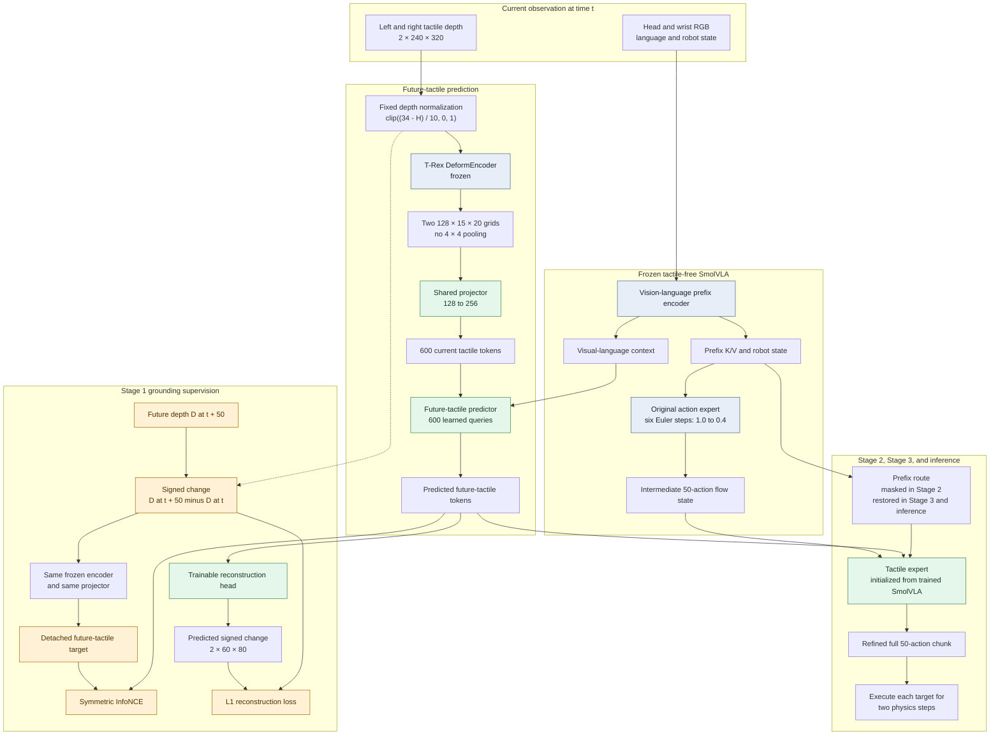

# Tactile Refinement

Current implementation: pretrained T-Rex full-grid tactile encoder with N₀-VTLA-style future-tactile grounding (September 13, 2026). See [IMPLEMENTATION.md](IMPLEMENTATION.md) for code, configuration and commands. Earlier experiment descriptions are preserved in `archive/`; they are not the active recipe.

The hypothesis is that predicted future tactile change can condition a separate action expert to refine a frozen, tactile-free SmolVLA's full action chunk. Training losses alone do not establish manipulation success; matched UniVTAC rollouts are required.

## Implementation diagram

Blue components are frozen, green components contain parameters trained in at least one stage, and orange components exist only for Stage 1 supervision. The shared projector is trained through the current-depth branch in Stage 1; its future-target output is detached after the same projector has been applied. The reconstruction head is used only for grounding training.

## Tactile representation

Use both ordered gripper depth maps, `tactile/left_gsmini/depth` and `tactile/right_gsmini/depth`, at 240×320. Normalize each map as

$$D_t=\operatorname{clip}((34-H_t)/10,0,1).$$

Depth is in millimetres. No episode-start frame is subtracted. Invalid pixels are masked. This is a normalized tactile depth representation, not a calibrated measurement of gel indentation or force.

Load the released pretrained **T-Rex DeformEncoder** weights and freeze its parameters and BatchNorm statistics. The source is [miniFranka/T-Rex_midtrain_mecka23k_ucb100_vqvae_epoch6](https://huggingface.co/miniFranka/T-Rex_midtrain_mecka23k_ucb100_vqvae_epoch6/tree/62efb3bcb45a3df0e088c8909d759b582cfb98af), pinned to revision `62efb3bcb45a3df0e088c8909d759b582cfb98af`. All 104 encoder state entries are loaded strictly. Our previous 110,000-update encoder is not used in this recipe.

Each finger produces a 128×15×20 feature grid. Flatten the **full 15×20 grid without 4×4 pooling**, then apply a shared trainable linear projector from 128 to 256 channels. Concatenate the fingers in left/right order: 600×256 tokens per observation. Learned spatial and sensor embeddings preserve their identities in the predictor.

## Stage 1: future-tactile grounding

The predictor sees current tactile tokens and frozen SmolVLA visual-language prefix features:

$$g_t=P(E(D_t)),\qquad \hat z_t=F(g_t,C_t).$$

The future-tactile target uses the **same encoder and the same projector**:

$$z_t^*=\operatorname{stopgrad}\left[P(E(D_{t+50}-D_t))\right].$$

Preserve the signed change, including negative values. Future frames are supervision only; they never enter the predictor's input. Endpoints crossing a recording discontinuity or episode boundary are masked, not clamped to the final frame. The current projector branch receives gradients; the target branch is detached. There is no separate target projector or EMA encoder.

Following the [N₀-VTLA grounding objective, equations 3–5](https://arxiv.org/html/2607.23782v1#S4.SS2), mean-pool tokens and L2-normalize those pooled vectors **only for the contrastive loss**. Use cosine similarities and symmetric in-batch cross entropy. A lightweight reconstruction head takes the predicted tokens and reconstructs a signed coarse future-change map:

$$\mathcal L_1=\mathcal L_{\mathrm{InfoNCE}}(\hat z_t,z_t^*)+\lambda_{\mathrm{rec}}\lVert R(\hat z_t)-\Delta D_{\mathrm{coarse}}\rVert_1,\qquad\lambda_{\mathrm{rec}}=1.$$

There is no additional latent regression loss, contact weighting, or autoencoder preparation stage. Train the projector, predictor and reconstruction head together; keep T-Rex and SmolVLA frozen. The head supplies a grounding loss during prediction training; it is not needed at deployment.

Our reconstruction output is two 60×80 maps, supervised using valid-pixel area means of the original signed change. This coarse supervision does **not** pool the encoder features: the predictor and action expert receive all 600 tokens. The depth modality, 600-token layout and reconstruction resolution are adaptations to this project, not an exact reproduction of N₀-VTLA's RGB architecture. We use the published cosine logits without a temperature parameter. Negatives come from each microbatch of 16; gradient accumulation does not create 64-example contrastive batches.

## Stage 2: tactile-conditioned action refinement

Freeze the encoder, projector, predictor and reconstruction head. Train only the separate tactile expert, initialized as an independent copy of the trained SmolVLA action expert. New tactile cross-attention and direct-state residual output projections start at zero. No LoRA is used.

The frozen SmolVLA runs six Euler steps from flow time 1 to 0.4. Let its intermediate full 50-action chunk be $Y$. Sample $\tau\in(0,0.4]$ and use the demo-to-handoff bridge

$$x_\tau=(1-\tau/0.4)A^{\mathrm{demo}}+(\tau/0.4)Y,\qquad v^*=(Y-A^{\mathrm{demo}})/0.4.$$

Train the expert's velocity with action-padding-masked MSE on the nine physical action dimensions. The expert conditions on the predicted future tactile tokens and direct robot state. **Its prefix K/V access is masked in Stage 2**, including the contextualized state-token path. The predictor and baseline handoff retain their original visual-language context.

The expert receives neither current tactile tokens directly nor an explicit predicted-minus-current latent error. Removing the direct tactile shortcut does not guarantee that the expert uses the predictor; tactile ablations are still necessary.

## Stage 3: joint refinement and deployment

Restore the tactile expert's prefix K/V access. Jointly train the projector, predictor and tactile expert using the action objective. Keep the pretrained T-Rex encoder, original SmolVLA and reconstruction head frozen. Future-tactile supervision is not used in this stage, so the learned latent may drift from its Stage 1 predictive interpretation; compare forecast diagnostics before and after joint training.

At inference, observe current RGB, language, robot state and depth, predict the future tactile tokens, run the original action expert's six steps, then finish denoising with four tactile-expert steps at 0.4, 0.3, 0.2 and 0.1. Each step updates the whole 50-action chunk. Execute each joint-position target for two physical steps, then observe again after the complete chunk, unless the environment terminates. There is no intermediate 10-action correction loop and no reconstruction head at inference.

## Data, schedule and validation

All 800 UniVTAC episodes remain available, with no training/validation split. Stage 1 masks examples without valid future supervision. Batch size is 16 with accumulation 4, effective batch 64, using bfloat16. Configured budgets are **100,000 grounding updates**, 20,000 expert updates and 10,000 joint updates. These are experiment budgets, not proven convergence thresholds. The current launch runs **grounding only and then exits**, saving checkpoints at 33,333, 66,666 and 100,000. An automatic continuation preserves the live run's first 10,000 updates and resumes through the new total; the earlier milestones are archived separately.

The pretrained encoder was trained on another tactile domain, and signed difference maps differ from its nonnegative pretraining inputs. Transfer quality remains an empirical question. Measure future-change reconstruction against zero-change predictions, latent variation and retrieval, then evaluate matched policies in UniVTAC using identical action holds, replanning intervals and seeds. Existing baseline rollouts with another execution schedule are not a matched comparison.
