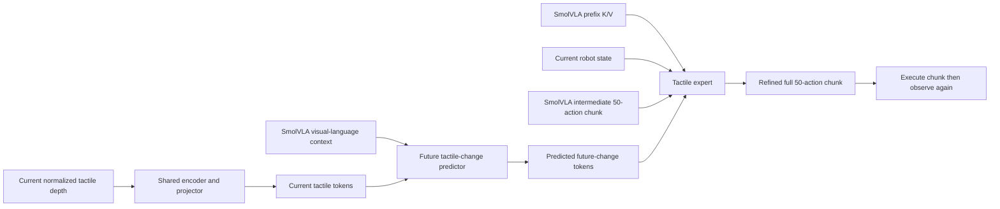

# Tactile Refinement

Final research design — September 12, 2026.

**Status:** This is a technically coherent experiment, not an implemented or empirically validated method. The hypothesis is that predicting future tactile depth changes from current touch and visual-language context can guide a separate expert to refine a complete SmolVLA action chunk toward the demonstrated chunk. Success must be demonstrated in closed-loop UniVTAC rollouts.

## Objective and scope

Use the trained vision-language-proprioception SmolVLA as a frozen motion planner. Add a shared tactile depth encoder, a future-change predictor, and a separate tactile expert that refines all 50 actions of each partially denoised chunk together. The predictor receives current tactile tokens and visual-language context; the tactile expert receives the predicted future-change tokens, prefix K/V context, robot state, and action flow state.

The tactile input is a single normalized tactile depth map from each gripper finger. No episode-start frame is subtracted, and no tactile history is required. The baseline retains its original observation inputs and weights throughout refinement training.

All 800 UniVTAC demonstration episodes remain available for training, with **no train/validation split**. Benchmark performance is measured through separate simulator rollouts with new evaluation seeds. Training-set reconstruction and action losses are diagnostics, not estimates of generalization.

The two conditioning paths are:

## 1. Normalized tactile depth maps

For finger $k\in\{L,R\}$, let $H_t^k$ be the recorded UniVTAC sensor depth. Convert it to a normalized tactile depth map using one fixed sensor range:

$$
D_t^k=\operatorname{clip}\!\left(\frac{H_{\rm far}-H_t^k}{H_{\rm far}-H_{\rm near}},0,1\right),
\qquad H_{\rm near}=24.0\ \mathrm{mm},\quad H_{\rm far}=34.0\ \mathrm{mm}.
$$

Equivalently, $D_t^k=\operatorname{clip}((34-H_t^k)/10,0,1)$. The 24–34 mm limits come from the fixed GelSight Mini camera clipping range in [UniVTAC's tactile configuration](https://github.com/univtac/UniVTAC/blob/main/envs/sensors/tactile.py#L49-L60). Do not estimate any normalization parameter from a frame or episode. This convention maps 34 mm to zero and smaller camera depths toward one. It is a normalized depth representation; it is not interpreted as physical gel deformation or indentation.

We follow the fixed-range normalization principle used by T-Rex: the [released T-Rex loader](https://github.com/ZhuoyangLiu2005/T-Rex/blob/f88e10c61da123c68bf0927cf4860bc97a0381f3/scripts/train.py#L273-L278) reads its already constructed 8-bit deformation images and divides them by 255. T-Rex does not subtract an episode-start tactile frame.

In our downloaded Isaac45 data, use **tactile/left_gsmini/depth** and **tactile/right_gsmini/depth**. Their frames are $240\times320$ float arrays in millimetres. The [UniVTAC sensor implementation](https://github.com/univtac/UniVTAC/blob/main/third_party/TacEx/source/tacex/tacex/gelsight_sensor.py) converts its height map to millimetres, and the [robot configuration](https://github.com/univtac/UniVTAC/blob/main/envs/robot/robot_cfg.py#L61-L68) confirms the 34 mm far plane.

Do **not** use the first frame as a zero-contact reference. An audit of all 800 downloaded episodes found that only the 200 `lift_bottle` and `lift_can` episodes start with both sensors exactly at 34 mm. The other 600 episodes start with contact on both sensors because task-specific `pre_move()` can grasp or insert the object before recording begins. The reset and recording order is visible in [UniVTAC's base task](https://github.com/univtac/UniVTAC/blob/main/envs/_base_task.py#L386-L430).

Use a fixed sensor-valid region and mask invalid depth pixels. Apply the same crop, resize, $H_{\rm far}$, and $H_{\rm near}$ to every frame in training and inference. Do not normalize each frame independently; doing so would erase the relationship to the fixed sensor depth range.

Construct the future-change map after normalizing the two absolute maps:

$$
\Delta D_{t,50}^k=D_{t+50}^k-D_t^k.
$$

Although $D_t^k\in[0,1]$, preserve $\Delta D_{t,50}^k\in[-1,1]$ as a signed float. Positive values indicate increasing normalized depth values and negative values indicate decreasing normalized depth values. These signs do not directly quantify compression, force, or release. Do not take the absolute value, clip negative changes, or convert change maps to unsigned images.

## 2. Shared tactile depth encoder using T-Rex's architecture

Use the actual **DeformEncoder** architecture in [T-Rex's released code](https://github.com/ZhuoyangLiu2005/T-Rex/blob/f88e10c61da123c68bf0927cf4860bc97a0381f3/qwen_vla/DeformAE.py):

| Component | Operation |
|---|---|
| Input stem | Single-channel $7\times7$ convolution, stride 2, 64 channels; batch normalization, ReLU, max pooling |
| Residual stages | ResNet-18 layer1, layer2, and layer3 |
| After layer2 | $3\times3$ convolution, $128\rightarrow128$, batch normalization, ReLU |
| After layer3 | $3\times3$ convolution, $256\rightarrow128$, batch normalization, ReLU |
| Output at our resolution | $128\times15\times20$ spatial feature map |

The code has two added projection blocks; follow this executable architecture rather than interpreting the paper's description as a projection after every stage. T-Rex pretrains the spatial encoder with an autoencoder and freezes it for policy learning. Its temporal force encoder is a separate component. [T-Rex, Appendix C](https://arxiv.org/html/2606.17055v1#A3)

Our token adapter $P$ applies a $4\times4$ adaptive spatial pool, flattens the 16 positions, and linearly projects each 128-dimensional feature to width $d=256$. This pooling and token width are our implementation choices. Keep the two fingers separate, giving 32 ordered tokens. Add sensor and position embeddings to conditioning tokens; preserve the same ordered slots in prediction targets. Do not average the fingers, since asymmetric contact matters.

Pretrain the shared $E$ and $P$ on **both** $D_t$ and signed $\Delta D_{t,50}$. Train a decoder from the projected tokens to reconstruct each input map using a valid-pixel, contact-weighted reconstruction objective. The decoder must reconstruct through the token bottleneck, without bypassing it. This grounds the projection as well as the encoder.

Then freeze $E$ and $P$, including batch-normalization running statistics. Reuse these exact weights on the current and target branches. Architectural reuse does not establish that T-Rex's sensor-specific weights transfer directly to UniVTAC or to signed change maps. The ability of this compact bottleneck to retain small contact patches must be checked through reconstruction.

## 3. Predict the change over the next 50 steps

Define current-contact tokens and the supervised target as

$$
g_t^k=P(E(D_t^k)),\qquad
z_t^{*,k}=\operatorname{stopgrad}\!\left[P(E(\Delta D_{t,50}^k))\right].
$$

Concatenate the left and right slots to obtain $g_t$ and $z_t^*$. The predictor receives only information available at decision time:

$$
\hat z_t=F_\phi(g_t,C_t),
$$

where $C_t$ is the contextualized visual-language prefix from frozen SmolVLA. Use 32 learned output queries, two cross-attention/FFN blocks, width 256, and eight attention heads as initial settings.

Cache both the contextualized prefix features and the base expert's per-layer K/V tensors. The predictor projects the prefix features into its own attention space; the copied tactile expert can reuse the base K/V layout. Prefix features and per-layer K/V caches are different tensor interfaces. Respect padding masks and verify cache-based inference against an uncached reference.

This target construction follows the endpoint-change formulation in [N0-VTLA, Section 2.2](https://arxiv.org/html/2607.23782v1#S2.SS2), which applies the tactile encoder to the future-minus-current image. Our substitutions are normalized tactile depth maps, the T-Rex CNN, and separate finger targets. In general,

$$
P(E(D_{t+50}-D_t))\ne P(E(D_{t+50}))-P(E(D_t)).
$$

The left-hand expression is the selected target. It is a **latent representation of future net tactile depth change**. The predictor supplies the future tactile condition for action refinement. We do not compute $\hat z_t-g_t$: these represent a future change and a current observation, respectively. The method uses predicted tactile conditioning, with no explicit prediction-error subtraction.

In Stage 1, ground the predictor with

$$
\mathcal L_{\rm pred}=
\mathcal L_{\rm Huber}(\hat z_t,z_t^*)
+\lambda_{\rm rec}\mathcal L_1(R(\hat z_t),\Delta D_{t,50})
+\lambda_{\rm NCE}\mathcal L_{\rm NCE}(\hat z_t,z_t^*).
$$

All terms use valid samples or pixels; reconstruction retains separate finger outputs. Initialize $R$ from the representation-pretraining decoder. N0-VTLA motivates symmetric contrastive supervision and spatial reconstruction; pointwise latent regression and a permanently frozen target projection are our stabilizing choices. Report reconstruction error in normalized depth units. Multiplying by 10 converts change errors to camera-depth millimetres on the unclipped range; this is not an indentation measurement.

For contrastive sampling, avoid nearby overlapping windows as negatives and mask duplicate or indistinguishable near-zero targets. Samples without distinct valid negatives still contribute regression and reconstruction. Gradient accumulation does not enlarge the simultaneous contrastive negative pool.

The [released N0-VTLA policy](https://github.com/neoteai/N0-VTLA/blob/03a0ce4d7091ca2354864796770715aa212601b7/n0vtla/models_pytorch/n0vtla_policy.py) explicitly omits the paper's supervised predictor-grounding stage. Our future-target construction and loss must therefore be implemented explicitly.

**Role:** The predictor estimates the future tactile transition from current touch and scene/task context. The tactile expert is trained to account for this forecast while transforming the SmolVLA chunk toward the corresponding demonstrated action chunk. Its prefix K/V conditioning preserves access to the original task and scene. The predictor deliberately does not take the proposed action as input; its forecast is learned from demonstrated transitions. Conditional imitation encourages action–tactile consistency, but does not guarantee the physical outcome: there is no explicit action-to-tactile dynamics model or outcome-consistency loss in this design.

## 4. Refine the entire action chunk

Let physical data time be $t$, and flow time be $\tau$. Use the SmolVLA convention: $\tau=1$ is Gaussian noise and $\tau=0$ is a completed action chunk.

The frozen base expert generates a 50-step intermediate action chunk. Here “SmolVLA action chunk” means the intermediate flow state $Y_t=x_{\tau_s}^{\rm SmolVLA}$, preserving the proposed flow handoff:

$$
Y_t=\operatorname{Integrate}\!\left(v_{\rm base},\epsilon;
\tau:1\rightarrow\tau_s\right),\qquad \tau_s=0.4.
$$

The tactile expert receives the evolving full-chunk flow state, flow time, robot state $q_t$, cached prefix K/V tensors, and predicted future-change tokens:

$$
v_\theta(x_\tau,\tau;\,KV_{\rm prefix},q_t,\hat z_t).
$$

It completes the trajectory from $\tau_s$ to zero for all 50 actions together. The current tactile tokens $g_t$ enter action generation only through $F_\phi$ and $\hat z_t$; there is no direct current-tactile input to the expert. **The expert receives predicted future-change tokens during both training and deployment.** Future ground-truth maps and latents are supervision only.

The intended mapping is

$$
(Y_t,\hat z_t,KV_{\rm prefix},q_t)
\longrightarrow \hat A_t\approx A_t^{\rm demo}.
$$

The expert may change any valid component of the full action chunk. The objective is demonstrated-action reconstruction conditioned on predicted future tactile information; no small-residual bound or joint-specific correction restriction is imposed.

Initialize the tactile expert by copying SmolVLA's trained action-expert weights, action/state/time projections, and output head. Add separate cross-attention residual blocks for the predicted future-change tokens, with zero-initialized output projections. Initialize their inner attention weights normally. This preserves the copied expert's initial computation while allowing the tactile route to learn. Numerically verify equivalence before training. Simply appending zero-valued tokens to an existing attention softmax does not guarantee equivalence.

Retain the baseline's normalized nine-dimensional action semantics, padded model slots, action masks, and controller conversion. An intermediate flow state is not an executable joint command.

### Train on the handoff states the expert will actually receive

[FM-Steer, Section 4.2](https://openaccess.thecvf.com/content/CVPR2026/papers/Song_FM-Steer_Enhance_Generalist_Policies_with_Value-Guided_Cascaded_Denoising_CVPR_2026_paper.pdf) trains its continuation module using intermediate actions sampled from a frozen VLA. Adopt this principle so the tactile expert encounters base-policy errors during training.

For each demonstration observation, sample $Y_t$ from frozen SmolVLA. Pair it with the demonstration action target $A_t^{\rm demo}$. With $\alpha=\tau/\tau_s$, define our refinement bridge

$$
x_\tau=(1-\alpha)A_t^{\rm demo}+\alpha Y_t,\qquad
v^*=\frac{Y_t-A_t^{\rm demo}}{\tau_s},
\quad 0<\tau\le\tau_s.
$$

In Stages 2 and 3, train refinement with masked velocity regression:

$$
\mathcal L_{\rm refine}
=\mathbb E\left[\left\|v_\theta(x_\tau,\tau;\cdot)-v^*\right\|_{\rm valid}^2\right].
$$

The scaling by $\tau_s$ is required because the expert integrates in the original $\tau$ coordinate. Resample base noise across training visits, or cache multiple seeds with the exact checkpoint and sampler metadata. Detach the base outputs and caches.

This bridge is our explicit continuation objective. Replacing Gaussian noise with $Y_t$ while keeping the Gaussian-to-demonstration velocity target would be inconsistent. The proposal adopts cascaded refinement from FM-Steer; it does not include FM-Steer's value verifier or best-of-N selection.

For initial deployment use six base Euler steps and four refinement steps, with step size $-0.1$. Each solver step updates the entire 50-action tensor. Cache $KV_{\rm prefix}$, $q_t$, and $\hat z_t$ for this refinement pass. Finish refining the complete chunk before execution, then execute its 50 actions in order, holding each target for two physics steps as specified in Section 5, subject to the environment's success, failure, and termination conditions. Acquire new observations and predict/refine a new chunk after that chunk ends. There is no intermediate 10-action tactile correction or replanning loop. Multiple numerical denoising steps do not imply multiple physical feedback cycles.

## 5. Three-stage training and execution timing

**Encoder preparation:** Before the three policy-training stages, pretrain the shared tactile depth encoder $E$, projector $P$, and decoder as described in Section 2. Freeze $E$ and $P$ for all three stages, including normalization statistics. This is representation preparation, separate from the three-stage predictor/expert recipe. When the target is written compactly as $E(D_{t+H}-D_t)$, that shorthand includes the frozen projection $P$; the explicit target in this document remains $P(E(D_{t+H}-D_t))$.

| Stage | Objective | Train | Freeze |
|---|---|---|---|
| 1. Future-tactile grounding | $\mathcal L_{\rm pred}$ from Section 3 | Predictor, its prefix adapter, prediction reconstruction head | Baseline SmolVLA; shared encoder/projector |
| 2. Tactile-conditioned action refinement | $\mathcal L_{\rm refine}$ from Section 4 | Copied tactile expert and predicted-latent conditioning adapters | Baseline; shared encoder/projector; grounded predictor, its prefix adapter, and reconstruction head |
| 3. End-to-end joint refinement | $\mathcal L_{\rm refine}$ only | Predictor, its prefix adapter, tactile expert, and predicted-latent conditioning adapters | Baseline; shared encoder/projector; Stage 1 reconstruction head |

### Stage 1: ground the future-change representation

Learn $\hat z_t=F_\phi(g_t,C_t)$ against the frozen target $z_t^*$. Use the latent regression, reconstruction, and contrastive objectives already defined in Section 3. Future frames are available only to the supervision branch. Preserve the Stage 1 checkpoint and reconstruction head for subsequent diagnostics.

### Stage 2: teach the expert to consume the prediction

Freeze the predictor in evaluation mode and train the expert to refine the entire intermediate SmolVLA action chunk toward its demonstrated target, conditioned on $(KV_{\rm prefix},q_t,\hat z_t)$. Use predicted $\hat z_t$ during training, never the ground-truth $z_t^*$. There is no direct $g_t$ input to the expert.

This removes the direct-current-tactile bypass. It does **not** mathematically force use of $\hat z_t$: the expert can still rely on the prefix, joint state, or SmolVLA action chunk. Preserve prefix conditioning as part of the chosen architecture and measure latent usage through removal/shuffling controls. Any claim that this stage teaches useful predictive-tactile conditioning depends on those results.

### Stage 3: adapt the predictor for action refinement

Unfreeze the predictor and optimize the action-refinement loss through the complete added pathway:

$$
\mathcal L_{\rm refine}
\longrightarrow \text{tactile expert}
\longrightarrow \hat z_t
\longrightarrow F_\phi.
$$

In this stage, future-target regression, contrastive loss, and tactile reconstruction loss are **not** optimization terms. The previously grounded representation is allowed to adapt for action generation. Recompute $\hat z_t$ with gradients enabled; do not detach it or reuse Stage 2 cached predictor outputs. Frozen base-prefix features and encoder outputs may remain cached.

“End-to-end” here refers to the predictor and tactile expert with their trainable adapters. The base vision encoder, language backbone, original action expert, and shared tactile encoder/projector remain frozen.

Action-only optimization can preserve useful predictive features, add current-contact information, or drift away from the original future-change target. Treat $\hat z_t$ as an action-adapted latent initialized by future-tactile grounding after this stage. Its continued interpretation as a future-tactile forecast must be checked, rather than guaranteed by the loss. Compare prediction/reconstruction diagnostics before and after joint training using the fixed target encoder and the saved Stage 1 reconstruction head, alongside rollout performance.

### Hold each action for two physics steps

For the selected Isaac45 setup, one physics step is $1/120$ second and adjacent valid recorded frames are two physics steps apart. Use the same cadence for executing each predicted target:

$$
\Delta t_{\rm action}=2\Delta t_{\rm physics}
=\frac{2}{120}\ {\rm s},\qquad
H\Delta t_{\rm action}=\frac{50\times2}{120}
\approx0.833\ {\rm s}.
$$

Apply one denormalized joint-position target and keep it unchanged while the simulator advances twice. This is a zero-order hold of a position target, not adding a joint displacement twice. Do not consume the next predicted action or recompute policy/tactile conditioning between the two physics steps. Count the pair as one policy action; check termination during execution so success or failure can end a chunk early.

Implement the action repeat at the policy-execution boundary. Do not globally change simulation decimation in a way that also changes reset/pre-move behavior. Verify simulated elapsed time and executed-action counts: 50 targets should advance 100 physics steps if the episode does not terminate early.

Refine all 50 targets before execution, hold each for two physics steps, execute the full chunk, then acquire new observations and repeat. The baseline used for the controlled comparison must use the same action hold and 50-target execution schedule. Results from a one-physics-step-per-action or 10-action-replanning baseline are different configurations and must be labelled separately.

### Data alignment

A training example at recorded index $t$ uses current observations at $t$, targets $q_{t+1},\ldots,q_{t+50}$, and tactile target $D_{t+50}-D_t$. Check the recorded step counters for every valid training segment. Two-step action holding aligns the nominal sampling horizon; recorded joint states remain target proxies, so matching cadence alone does not establish that replay reproduces demonstration dynamics.

Future targets must stay inside the same episode and continuous recording segment. If $t+50$ is unavailable or crosses a recording discontinuity, mask the future losses in Stage 1; retain valid action training in Stages 2 and 3 with its own horizon mask. Do not silently clamp the endpoint or cross episode boundaries. Invalid depth pixels are masked in both the current map and future-change target.

All 800 episodes remain in the training corpus, with no train/validation split. Eligibility masks enforce valid supervision. Overlapping action chunks are acceptable, but Stage 1 contrastive sampling must account for correlated samples. Measure GPU memory and throughput before assigning microbatch sizes or stage durations.

## 6. Strict assessment and required evidence

The architecture is valid as a research hypothesis. The combination of a normalized tactile depth representation, endpoint prediction, and full-chunk action refinement is an incremental synthesis of existing mechanisms. Its contribution would be demonstrated improvement from predicted tactile depth-change conditioning under a controlled frozen-baseline comparison.

The main limitations are:

- A single depth-derived map measures surface geometry. It does not uniquely identify tangential force, friction, slip velocity, or the required joint correction.
- Endpoint subtraction loses intermediate events. Contact followed by release can give nearly zero change, as can a stable loaded grasp. The predictor observes the current state, but its endpoint-change target cannot encode the complete intervening contact trajectory.
- Demonstrations teach continuation toward demonstrated actions. They provide limited coverage of failed grasps and recovery states; low offline loss does not establish robust correction.
- All 50 refined actions execute before another tactile prediction. Unexpected contact changes within a chunk cannot trigger a new tactile refinement pass in this design.
- Stage 2 does not guarantee that the expert uses its predicted tactile condition. Stage 3 can change the latent's predictive meaning because only the action objective remains.

Evaluate on the same new simulator seeds, task settings, and full-chunk execution schedule. A baseline evaluated with 10-action replanning is a separate controller configuration; compare against a 50-action-execution baseline before attributing gains to tactile prediction:

| Comparison | Question |
|---|---|
| Original SmolVLA | Reference success, execution time, and contact failures |
| Copied continuation expert without tactile inputs | Does the additional training or expert alone explain the gain? |
| Current-depth ablation: replace predicted tokens with projected current tokens | Does predicting future change help beyond conditioning on current touch? |
| Full model: predicted future-change conditioning | Does prediction improve full-chunk refinement? |

The current-depth ablation is an experimental control only. The proposed deployed expert receives $\hat z_t$ and has no direct $g_t$ input.

Also perturb or shuffle tactile inputs and predicted tokens to test whether the policy uses them. Report per-task success and confidence intervals, drops or failed grasps, and inference latency. Report normalized tactile depth reconstruction error separately for non-contact, contact onset, sustained contact, and unloading.

Check prediction against a zero-change forecast and a constant training-target forecast. Repeat these diagnostics after Stage 3 to distinguish retained predictive grounding from improved action performance with a changed representation. Use independent evaluation rollouts for generalization measurements; label any training-corpus retrieval results accordingly. Do not count nearby overlapping windows as independent evidence.

Implementation acceptance requires fixed dataset-wide normalization, preserved signed changes, non-collapsed representations, correct future/action alignment and two-physics-step action holds, no future-target leakage, initial copied-expert equivalence, and improved task performance over the current-depth conditioning control.
