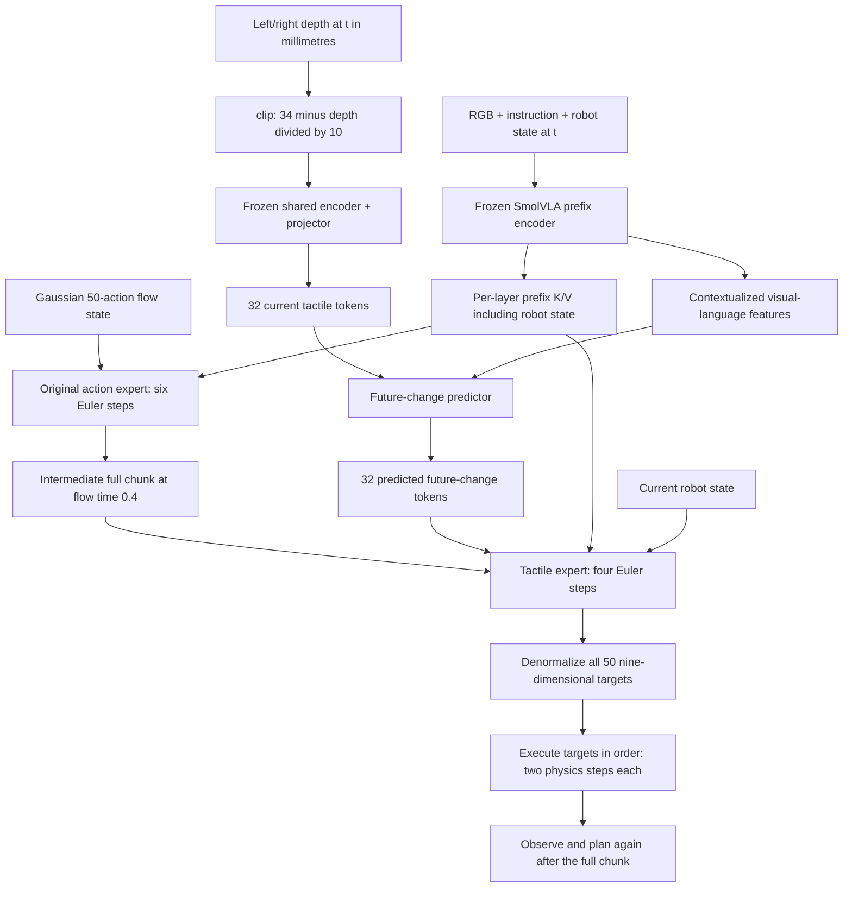

# Tactile refinement implementation

This document describes the executable implementation of the final design in
[README.md](README.md). Source code is in [src/tactile_refinement](../src/tactile_refinement).
The baseline checkpoint is the completed, tactile-free SmolVLA fine-tune. The new
modules require training before their rollout performance can be assessed.

## What is implemented

- The T-Rex **DeformEncoder topology**, initialized from scratch: one-channel
  ResNet-18 stem and layers 1–3, with the two released 128-channel projection blocks.
  Reference: [pinned T-Rex source](https://github.com/ZhuoyangLiu2005/T-Rex/blob/f88e10c61da123c68bf0927cf4860bc97a0381f3/qwen_vla/DeformAE.py).
- A shared encoder/projector producing **32 × 256 tokens**, retaining 16 ordered
  spatial slots for each of the left and right sensors.
- A decoder that reconstructs maps exclusively through these projected tokens.
- A future-change predictor with 32 learned queries, two transformer decoder
  blocks, eight attention heads, and a trainable visual-language context adapter.
- A separate, dense tactile action expert copied from the trained SmolVLA baseline,
  with zero-output tactile cross-attention residuals after each layer.
- Encoder preparation and all three policy-training stages, optimizer resumption,
  checkpoint provenance checks, and three checkpoint files **per stage**.
- Full-chunk inference, live UniVTAC depth transfer, two-physics-step action holds,
  a matched baseline benchmark, rollout videos, and per-task success summaries.
- Training-corpus forecast diagnostics and inference-time conditioning perturbations.

No LoRA is used in the added modules. The original SmolVLA vision encoder,
language backbone, action expert, and projections remain frozen in every stage.
There is no train/validation split: all 800 demonstration episodes remain in the
corpus. Invalid horizons are supervision masks, not a held-out dataset.

## Execution path



1. `TactileEpisodes.__getitem__` reads the current RGB, instruction, joint state,
   and the two depth maps. Grounding/encoder preparation additionally read the
   future endpoint when it exists. The baseline preprocessor receives only its
   original allowlisted inputs and action labels.
2. `normalize_depth` applies `clip((34 - H) / 10, 0, 1)` to both sensors. The fixed
   sensor region is the full 240 × 320 rectangle, without cropping or resizing.
   Nonfinite and nonpositive depths are masked and filled with normalized zero.
   Finite positive values outside 24–34 mm are clipped. No episode-start frame
   is subtracted, and no per-frame statistics are estimated.
3. `encode_prefix` computes the frozen SmolVLA prefix once per decision. The
   predictor sees contextualized **visual-language tokens**, excluding the state
   token and padding. The action expert receives the original per-layer K/V cache,
   which retains the baseline state conditioning. These are distinct interfaces.
4. `TactileRepresentation` converts each depth map into a 128 × 15 × 20 feature
   grid, pools it to 4 × 4, and projects each spatial feature to width 256.
5. `Predictor` combines current tactile tokens and VL context to produce the
   predicted future-change tokens. Sensor/position embeddings distinguish the
   current finger slots, and learned output queries retain ordered target slots.
6. `RefinementModel.handoff` samples fresh Gaussian noise and runs the original
   action expert at times `1.0, 0.9, ..., 0.5`, producing `Y = x_0.4`.
7. `CachedTactileExpert` continues at `0.4, 0.3, 0.2, 0.1`, with Euler step `-0.1`.
   Every solver step updates the full 50-action tensor. The expert receives the
   predicted tokens, prefix K/V, and state; it has no direct current-depth input.
8. The baseline postprocessor converts the first nine output slots back to joint
   radians/finger metres using the **original full-dataset action statistics**.
   The controller conversion is unchanged: the first gripper coordinate controls
   both fingers through UniVTAC's existing eight-coordinate `qpos` API.
9. The benchmark executes all 50 targets before planning again. Each position
   target is held for two physical steps, while counting as one policy action.
   Success/failure can terminate a hold or chunk early. Reset/pre-move decimation
   is unchanged. Fifty uninterrupted targets advance 100 steps, about 0.833 s.

The tactile expert copies the transformer, action input/output projections, time
MLPs, and state projection from `runs/smolvla_full_dense_b16_ga4_72h/final.pt`.
This is your trained, tactile-free UniVTAC SmolVLA checkpoint. Copies have identical
initial values and independent storage; training the new expert does not change
its frozen source. Attention masks, rotary positions, layer mapping, and K/V
shapes are preserved.

The additional tactile cross-attention blocks use zero-initialized output
projections. The copied direct state projection feeds a new zero-output state
adapter. These residual paths start at zero so initial expert velocities and
full 6+4-step chunks match the original baseline. Their output weights begin
learning in Stage 2. Ordinary initialization is used for the inner attention weights.

N0-VTLA also uses a pretrained action expert; this implementation uses SmolVLA
and a separate continuation module. No pi0.5 weights are used.

## Supervision and stage boundaries

At recorded index `t`, the action labels are `q[t+1:t+51]`. The future-change
target is the **signed map** `D[t+50] - D[t]`, encoded with the frozen shared
encoder/projector. It is not a subtraction between two encoded latents.

The existing manifest contains 801 continuous segments from 800 episodes,
including the recording reset in `lift_can/62`. The loader verifies two-step
recorded cadence. Action labels and future endpoints cannot cross segment
boundaries. At segment ends, valid action slots remain usable; unavailable
future targets are not clamped to the last frame.

| Stage | Trainable modules | Loss and data |
|---|---|---|
| Encoder preparation | Encoder, projector, token decoder | Reconstruct both current maps and valid signed change maps through the token bottleneck |
| 1: `grounding` | Predictor, VL adapter, decoder | Huber latent regression + masked depth reconstruction + symmetric in-batch InfoNCE |
| 2: `expert` | Pretrained SmolVLA expert, tactile residual blocks, copied action/time/state projections and state adapter | Continuation velocity regression with the entire expert prefix masked, using predicted tactile tokens and direct robot state |
| 3: `joint` | Predictor/VL adapter and all Stage 2 modules | Restore full expert prefix access; continuation loss only; gradients pass through predicted tokens into the predictor |

Encoder/projector weights and batch-normalization statistics are frozen after
preparation. The Stage 1 decoder remains frozen in Stages 2 and 3, so it can be
used for comparable reconstruction diagnostics after joint adaptation. Future
tactile frames are **not read at all** by the Stage 2/3 data loaders.

`stage2_mask_prefix: true` masks the tactile expert's **entire cached prefix**
during Stage 2 loss computation. This includes the state token, whose cached
representation already contains visual-language context. Direct normalized
proprioception remains available through the expert's separate state projection.
The predictor and frozen SmolVLA handoff generator retain their full context.
Stage 3 and inference restore normal expert prefix access automatically.

SmolVLA mixes action self-attention with prefix-only cross-attention. Masked
self-attention receives an empty prefix cache, preserving action attention and
rotary positions. Prefix-only attention produces an explicit zero contribution,
avoiding the upstream eager softmax's uniform output for an entirely masked row.
MLPs and tactile cross-attention residuals continue operating in these layers.
Their prefix-specific Q/K/V weights receive no gradient from the disabled branch
in Stage 2 and become active again in Stage 3. This removes direct prefix access;
the initial action chunk can still carry visual-language information.

For a sampled `0 < tau <= 0.4`, the continuation training path is:

```text
Y = frozen_smolvla_handoff(current_observation, fresh_noise)
alpha = tau / 0.4
x_tau = (1 - alpha) * demonstrated_chunk + alpha * Y
target_velocity = (Y - demonstrated_chunk) / 0.4
loss = masked_MSE(tactile_expert(x_tau, tau, prefix_KV, state, predicted_tokens,
                               mask_prefix=(stage == "expert")),
                  target_velocity)
```

Velocity loss excludes padded action times and the 23 unused model dimensions.
Each observation has equal weight after averaging its valid action slots.
Reconstruction uses valid pixels with extra weight where the input map has
nonzero magnitude. Negative signed changes are preserved in preprocessing,
reconstruction, and targets. InfoNCE excludes overlapping windows from the same
segment, near-zero changes, and nearly identical target maps. Gradient
accumulation does not expand its in-batch negative pool.

## File map

| File | Responsibility |
|---|---|
| [data.py](../src/tactile_refinement/data.py) | Depth normalization, signed endpoint targets, segment/cadence checks, separate baseline/tactile batches |
| [representation.py](../src/tactile_refinement/representation.py) | T-Rex encoder topology, 32-token bottleneck, decoder, predictor |
| [model.py](../src/tactile_refinement/model.py) | Frozen prefix cache, pretrained SmolVLA expert initialization, tactile conditioning, stage freezing, six-plus-four inference |
| [losses.py](../src/tactile_refinement/losses.py) | Masked reconstruction/regression/contrastive losses and refinement bridge |
| [train.py](../src/tactile_refinement/train.py) | Stage sequence, accumulation, checkpointing, resume, provenance checks |
| [execution.py](../src/tactile_refinement/execution.py) | Two-step target holding with one policy-action count |
| [sim_bridge.py](../src/tactile_refinement/sim_bridge.py) | Opt-in depth transfer through the existing private simulator socket |
| [benchmark.py](../src/tactile_refinement/benchmark.py) | Full-chunk rollouts, matched baseline mode, videos, success summaries |
| [diagnostics.py](../src/tactile_refinement/diagnostics.py) | Reproducible training-corpus forecast/reconstruction checks against zero-change forecasts |
| [tactile_refinement.json](../configs/tactile_refinement.json) | Training paths, batch/accumulation, learning rates and update budgets |

## Run training

Use the existing `.venv-train` and `.venv-benchmark`; no additional packages are
required. Commands below assume `/tactile/new` as the working directory.

```bash
# Run encoder preparation and all three stages in order.
bash scripts/train_refinement.sh --stage all

# Or detach the same pipeline so it survives SSH disconnects.
bash scripts/start_refinement.sh --stage all
tail -f logs/tactile_refinement.log
```

The default recipe uses batch size **16**, gradient accumulation **4** (effective
batch 64), and bfloat16 autocast. The encoder budget was extended from 10k to
110k total updates after the 10k audit showed weak small-change recall; this is
100k additional updates. The later budgets remain 10k/20k/10k updates and
learning rates 1e-4/1e-4/5e-5/1e-5 are explicit initial experiment settings, not
a validated optimum or a claim that this pipeline lasts three days. Timings
should be measured before assigning a wall-clock budget.

`expert_initialization` is explicitly `trained_smolvla_baseline_v1`. A persistent
initialization-version buffer rejects incompatible random-expert checkpoints.
Resuming a compatible checkpoint restores its learned expert weights normally.

An encoder/grounding checkpoint from before the Stage 2 masking change can resume
with `stage2_mask_prefix` enabled if every other configuration field is identical.
Those earlier phases are unaffected; optimizer and RNG state are preserved. Changing
this setting while resuming Stage 2/3 is rejected to prevent mixing training objectives.

Every stage writes `checkpoint_1.pt`, `checkpoint_2.pt`, and `final.pt`, at roughly
one-third, two-thirds, and completion. This gives 12 files across preparation
and the three policy stages. Each checkpoint includes the added modules,
optimizer, RNG states, stage/update, configuration, and SHA-256 fingerprints of
the baseline checkpoint and dataset manifest. Baseline weights are referenced
instead of duplicated. The original checkpoint must remain available.

```bash
# Start just Stage 1 from completed encoder preparation.
bash scripts/train_refinement.sh --stage grounding \
  --init runs/tactile_refinement/encoder/final.pt

# Resume the saved stage and continue all remaining stages.
bash scripts/start_refinement.sh --stage all \
  --resume runs/tactile_refinement/expert/checkpoint_2.pt

# Profile all module configurations using short real-data updates, without saves.
PYTHONPATH=src .venv-train/bin/python scripts/profile_refinement.py --updates 1
```

An existing output stage is rejected on a fresh launch. Use `--resume` to
continue it, or change `output_dir` in a separate recipe for a new experiment.
Resume restores the update-indexed sampler and stochastic model RNG; it does
not repeat completed updates unless an earlier checkpoint is selected.
Increasing only the encoder's terminal update count is a supported resume
migration. All other settings must match. Launching `--stage encoder` makes the
process exit after that encoder budget, leaving later stages paused.

## Benchmark and diagnostics

```bash
# Refined policy; first three videos per task and per-task success totals.
bash scripts/benchmark_refinement.sh \
  --checkpoint runs/tactile_refinement/joint/final.pt \
  --output runs/benchmark/refinement_full50_hold2

# Controlled baseline with exactly the same execution schedule and seeds.
bash scripts/benchmark_refinement.sh --baseline \
  --output runs/benchmark/baseline_full50_hold2

# Diagnose Stage 1 and Stage 3 with the same sample seed for comparison.
PYTHONPATH=src .venv-train/bin/python -m tactile_refinement.diagnostics \
  --checkpoint runs/tactile_refinement/grounding/final.pt \
  --output runs/tactile_refinement/grounding_diagnostics.json
PYTHONPATH=src .venv-train/bin/python -m tactile_refinement.diagnostics \
  --checkpoint runs/tactile_refinement/joint/final.pt \
  --output runs/tactile_refinement/joint_diagnostics.json
```

The new benchmark defaults to 100 episodes per task, fresh seeds starting at
1,000,000, and three videos per task at nominal 60 action frames/s. Results are
`metadata.json`, `episodes.jsonl`, `summary.json`, and `videos/<task>/*.mp4`.
Use `--resume` to skip completed episodes; metadata must match. It does not
automatically upload a new experiment to Hugging Face.

`--condition zero` and `--condition current` provide inference perturbations.
The model API also supports predicted-token shuffling for batches larger than
one. These controls test sensitivity; they are not separately trained ablation
models. The current-depth and no-tactile controls in the research design still
require their own controlled training experiments.

The existing background baseline evaluation retains its original 10-action
replanning and one-step-hold configuration. Its scores should not be used as the
matched baseline for attributing gains to the new method.

## Verification and practical limits

### Testing whether encoder preparation is sufficient

Run the encoder-only audit without loading SmolVLA or changing training weights:

```bash
PYTHONPATH=src .venv-train/bin/python scripts/audit_tactile_encoder.py
# Optionally keep the audit alive to evaluate final.pt when training saves it:
PYTHONPATH=src .venv-train/bin/python scripts/audit_tactile_encoder.py --wait-for-final
```

The audit uses fixed early/middle/late samples from every episode and valid
continuous segment, separately for current depth and signed t+50 change maps.
The first audit contains 4,754 two-finger maps from all 800 training episodes.
It does not create a holdout or exclude those samples from training.

For each encoder checkpoint it measures mean and active-region reconstruction
error, positive/negative change recall, contact support IoU, small-patch errors,
per-task errors, and latent variation. It compares against zero maps and a
per-task/type mean map fitted on these same diagnostic samples (an optimistic
control). Diagnostic active thresholds are 0.01 and 0.05 normalized depth; these
are measurement choices, not established thresholds for adequate manipulation.

Checkpoint improvements use paired samples and an episode-cluster bootstrap,
avoiding treating overlapping windows as independent experiments. This is a
convergence diagnostic on the training corpus, not a generalization estimate.
No fixed number of updates or single reconstruction metric proves readiness.
Check fine contacts and signed changes, then future prediction and downstream
rollouts; extending training is justified if meaningful errors keep improving.

Results are in `runs/diagnostics/encoder_readiness/`: `REPORT.md`, `report.json`,
per-sample CSVs, and `report.html` with fixed-scale reconstruction/error heatmaps.
With `--wait-for-final`, interim results are written first and automatically
updated when the atomic 10,000-step encoder checkpoint appears. The current
training schedule is not changed by this audit.

```bash
PYTHONPATH=src .venv-train/bin/python -m pytest -q tests
PYTHONPATH=src .venv-train/bin/python scripts/verify_refinement.py
PYTHONPATH=src .venv-train/bin/python scripts/verify_refinement_training.py
PYTHONPATH=src OMNI_KIT_ACCEPT_EULA=YES OMNI_KIT_ALLOW_ROOT=1 \
  .venv-train/bin/python scripts/verify_refinement_sim.py
```

Reports are written under `logs/refinement_*verification.json` and
`logs/refinement_profile.json`. The real-checkpoint integration check verifies
copied expert weights without shared storage, initial velocity/full-chunk equivalence, baseline cached/uncached equivalence,
finite forward/backward updates in every stage, the Stage 3 predictor gradient
path, and checkpoint round-trip inference. The CLI check exercises resumption,
stage transitions, all checkpoint milestones, and diagnostic loading. The live
simulator check measures actual action and physics counts with stationary targets.

### Frozen encoder and pooling probe

`scripts/probe_encoder_pooling.py` compares our 110k encoder and the T-Rex
deformation encoder with and without adaptive 4×4 pooling. The full feature grid
is 15×20 per finger. It freezes encoders and BatchNorm, excludes the learned
policy projector, standardizes each feature channel using probe-corpus moments,
and fits identically initialized decoders with identical batches and objectives.
Both branches enter the same decoder at 15×20; the pooled branch is interpolated
back to that size first. Thus decoder parameter count is identical.

This is a bounded reconstruction probe on the same 4,754 examples used for
fitting and diagnostics, from all 800 training episodes, without a split. It is
not a held-out or downstream-policy benchmark. The defaults are two seeds
(42 and 314), 2,000 decoder updates per seed, batch 16 and AdamW learning rate
0.001. Both current depth and signed future change are tested; signed changes
remain outside the T-Rex encoder's nonnegative current-map pretraining domain.

The T-Rex model is pinned to revision
`62efb3bcb45a3df0e088c8909d759b582cfb98af` of
`miniFranka/T-Rex_midtrain_mecka23k_ucb100_vqvae_epoch6`.
`scripts/extract_trex_encoder.py` retrieves only the required tensors through
HTTP ranges, parses metadata with PyTorch's restricted weights-only unpickler,
and strictly validates all 104 encoder state entries. Provenance records the
pinned revision and encoder tensor hashes. Main policy training remains paused.

```bash
PYTHONPATH=src .venv-train/bin/python scripts/extract_trex_encoder.py
PYTHONPATH=src:scripts .venv-train/bin/python scripts/probe_encoder_pooling.py
PYTHONPATH=src .venv-train/bin/python scripts/profile_tactile_token_grids.py
```

Outputs: `runs/diagnostics/encoder_pooling_probe/REPORT.md`, `report.json`,
per-example CSVs, matched heatmaps, fitted decoder checkpoints and feature cache.
The token profiler measures a synthetic predictor-only forward/backward with
batch 16 and 512 prefix tokens; it does not establish full-pipeline throughput.

Verification performed on September 12, 2026:

- **17 tests passed**, including baseline tests, copied-weight equality, independent
  storage, and zero-output tactile/state adapter checks.
- The real-checkpoint check verifies copied transformer matrices and action/time/state
  projection weights, initial baseline velocity and full-chunk equivalence, and
  baseline cached/uncached equivalence. It also checks finite training updates and
  checkpoint round-trip inference.
- Prefix-masking tests cover mixed self/cross-attention, removal of the contextualized
  state-token route, finite outputs, zero prefix gradients, and nonzero tactile/direct
  state gradients. On the real checkpoint, perturbing cached K/V gives exactly zero
  output difference when masked; unmasked access changes the output as expected.
  Real stage-loss and inference calls verify the correct masking mode is selected.
- All four training configurations completed finite forward/backward updates.
  The baseline had no gradients; the encoder/projector had no gradients after
  preparation; all 43 predictor parameter tensors received nonzero gradients
  in the Stage 3 integration check.
- The earlier pipeline CLI check resumed from encoder update one and completed preparation and
  all three stages, with three checkpoint files per stage. Diagnostic loading
  from the final checkpoint passed. Temporary test checkpoints were removed.
- The live `insert_HDMI` timing check executed **50 targets / 100 physics steps /
  0.833333 seconds**, with two valid 240 × 320 depth maps and 83 attachment points
  per sensor. This was a stationary timing check, not a successful policy rollout.
- The earlier batch **16**, accumulation **4** probe completed one optimizer update
  per stage on the RTX 3090 while baseline evaluation continued. These timings
  used the same pretrained-copy initialization and tensor dimensions:

| Stage | Peak PyTorch allocated memory in this process | Seconds for the short update |
|---|---:|---:|
| Encoder preparation | 3.50 GiB | 1.51 |
| Grounding | 2.12 GiB | 1.95 |
| Expert | 2.96 GiB | 2.35 |
| Joint | 2.99 GiB | 2.34 |

These memory figures exclude other GPU processes, CUDA context overhead, and
unallocated reserved memory. The timings are single-update measurements with
concurrent simulation, not a reliable long-run duration estimate.

These checks establish implementation behavior, not prediction quality or task
success. Encoder reconstruction quality/non-collapse, retention of predictive
meaning after Stage 3, useful tactile conditioning, and superiority over the
trained controls remain empirical questions. Verification commands only run short checks. The production pipeline is launched
with `bash scripts/start_refinement.sh --stage all`; its PID and log are in `logs/`.
